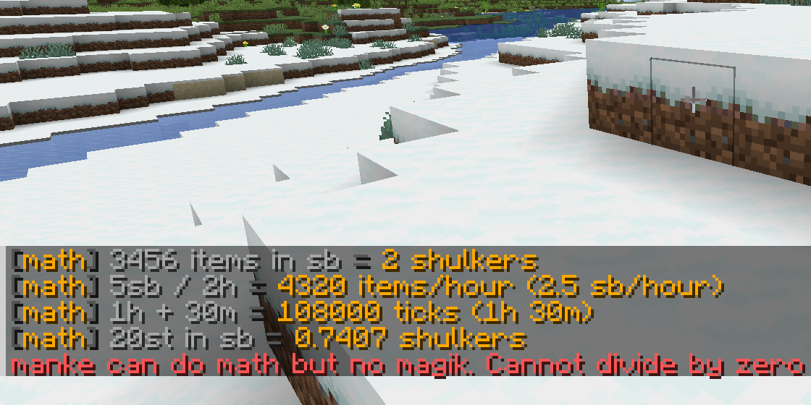

# MankeDoMath

A calculator inside Minecraft that knows what a shulker is.

Quick sums without leaving the game: farm rates, how many shulkers a pile of
items is, how long something takes to fill.

**Server-side only.** Players install nothing, and vanilla clients still get
autocomplete for the command.

```
/m 3456 items in sb      ->  2 shulkers
/m 5sb / 2h              ->  4320 items/hour (2.5 sb/hour)
/m (16*16*64) in st      ->  256 stacks, what one chunk section is worth
/m 20st in sb            ->  0.7407 shulkers
/m 1h + 30m              ->  108000 ticks (1h 30m)
```



Results are only shown to whoever asked. `/math share` posts one to public chat.

## Installation

Supports Minecraft 1.21 through 26.3. Download the jar for your Minecraft version from [GitHub Releases](https://github.com/CodeW4VE/MankeDoMath/releases) or [Modrinth](https://modrinth.com/mod/mankedomath), put it in the server's `mods/` folder and restart. Players do not need the mod.

Minecraft 26.3 requires Java 25, Fabric Loader 0.19.5 or newer and Fabric API for 26.3. Earlier 1.21 versions use Java 21. Replace the old jar when updating and retain `config/mankedomath.conf` to keep your settings.

## Commands

| Command | What it does |
| --- | --- |
| `/w4ve math <expression>` | The canonical spelling |
| `/math <expression>` | Short alias |
| `/m <expression>` | Shortest alias |
| `/math help` | The examples above, clickable |
| `/math ans` | Your last result. Works inside expressions too: `/math ans / 64` |
| `/math share <expression>` | Post the result to public chat |
| `/math reload` | Rereads the config (operator level 2) |

## Units

| Suffix | Is | Example |
| --- | --- | --- |
| `st` | stack, 64 | `3st` = 192 |
| `sb` | shulker box, 27 stacks | `2sb` = 3456 |
| `dc` | double chest, 54 stacks | `1dc` = 3456 |
| `t` | ticks | `600t` = 30s |
| `s` `m` `h` | seconds, minutes, hours | `1h` = 72000t |
| `b` `c` `r` | blocks, chunks, regions | `2c` = 32 blocks |

Longer spellings work too (`stacks`, `shulkerboxes`, `items`, `minutes`, `chunks`),
with or without a space after the number. `sh` is still accepted for a shulker
box if that is what your fingers already do.

Convert with `in`:

```
/math 3456 items in sb
/math 100 blocks in c
/math 5sb in st
```

Units carry through the arithmetic: `5sb / 2h` is printed as a rate per hour,
and `1sb + 1h` is an error.

**Operators**: `+ - * / % ^`, brackets, and a lone `x` between numbers as
multiplication. **Functions**: `sqrt min max abs floor ceil round log ln`.

<!-- modrinth:end -->

## When you get it wrong

```
/m 1/0        ->  dividing by zero is how you summon things. Cannot divide by zero
/m 1sb + 1h   ->  you cannot add cats and tuesdays. Cannot add time and items
/m 9^9^9      ->  that number does not fit in minecraft. Exponent 387420489 is over the limit of 64
/m banana     ->  manke can do math but no reading minds. Unknown name 'banana'
```

The joke always comes with the real reason, and the exact character that broke
is underlined. Set `funny_errors=false` to drop the jokes.

## Safety

There is no `eval` and no scripting engine. The parser is hand written and only
reads this small math grammar, so it cannot run anything else on the server.

Expression length, nesting depth and operation count are all checked before a
single multiplication happens, and the exponent cap is checked before each power
is computed, so `9^9^9` is refused with a message instead of lagging the server. All four
limits are in the config.

## Config

`config/mankedomath.conf`, plain `key=value` text, commented. Everything reloads
with `/math reload` except the command names, which are built into the command
tree at server start. The file says which is which.

```
short_alias=true
aliases=math, m
funny_errors=true
max_length=256
max_depth=16
max_exponent=64
max_operations=500
decimals=4
click_to_copy=true
share_needs_permission=false
```

## Building

```
./gradlew build
```

Needs JDK 21. The jar lands in `build/libs/`. The `math` package is plain Java
with no Minecraft in it and has its own tests, which run in CI on every push:

```
./gradlew test
```

## License

MIT. Part of [W4VE](https://github.com/CodeW4VE), Ware 4 Vanilla Experience.
